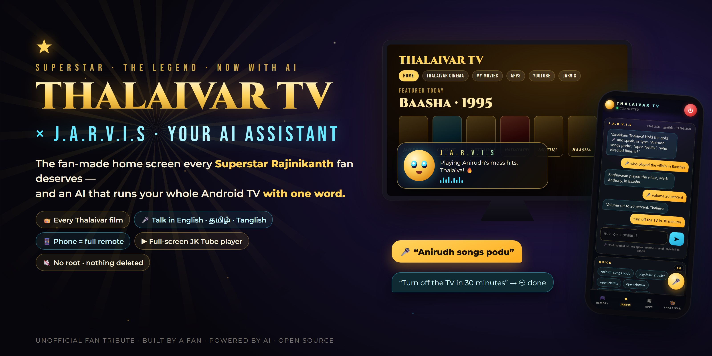
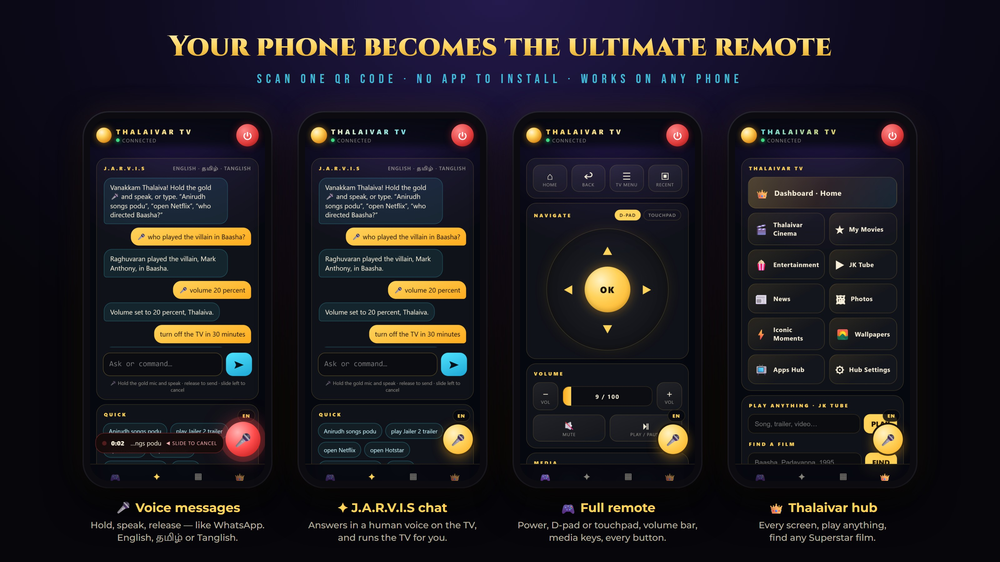
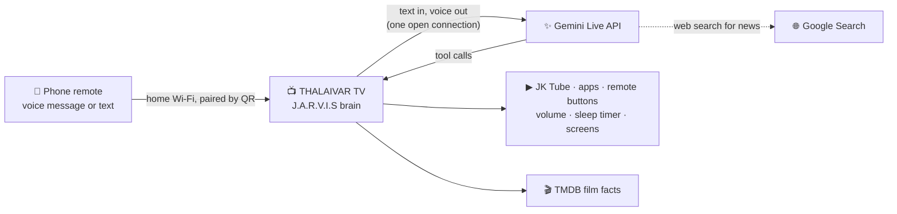

<p align="center"></p>

<h1 align="center">THALAIVAR TV ⭐ × J.A.R.V.I.S</h1>

<p align="center">
  <b>The fan-made home screen every Superstar Rajinikanth fan deserves — and an AI that runs your whole Android TV with one word.</b><br>
  Say it from your phone in English, தமிழ் or Tanglish. J.A.R.V.I.S answers in a human voice and does it: plays the song,
  opens the app, turns the volume down, switches the TV off in 30 minutes.<br>
  No root. Nothing deleted. One command to install, one to undo.
</p>

<p align="center">
  
  
  
  
  
  
  
</p>

<p align="center">
  <a href="#-meet-jarvis"><b>Meet J.A.R.V.I.S</b></a> ·
  <a href="#-your-phone-becomes-the-remote"><b>Phone remote</b></a> ·
  <a href="#-features"><b>Features</b></a> ·
  <a href="#install-in-3-steps"><b>Install</b></a> ·
  <a href="docs/GUIDE.md"><b>Full guide</b></a>
</p>

---

## Why

Your TV's home screen is full of ads and "sponsored" rows, and its assistant doesn't know who Baasha is.
**THALAIVAR TV** replaces both: a premium, cinematic home made for Thalaivar fans, and **J.A.R.V.I.S**, an AI
assistant that knows his films, speaks your language and controls the TV for you. It is built on top of the
excellent open-source **[Clean Your TV](https://github.com/Gathin23/cleanyourtv)** launcher (ad-free,
tracker-free, works on almost every Android TV).

## 🤖 Meet J.A.R.V.I.S

Hold the gold 🎤 on your phone and speak, like sending a WhatsApp voice message. Or just type. J.A.R.V.I.S
answers through the **Gemini Live API**: the human voice starts on your TV while the answer is still being made,
and the words show up on your phone.

| You say | J.A.R.V.I.S |
|---|---|
| *"Anirudh songs podu"* | Fixes the request, finds matching Tamil songs and plays them full screen, one after another |
| *"Play the Baasha auto song"* | Plays **Naa Autokaran (From "Baasha")**, the video whose title actually matches, never a random one |
| *"Who played the villain in Baasha?"* | "**Raghuvaran** played the villain, Mark Anthony." Film facts come from the TV's own film database, not guesses |
| *"Jailer 2 box office?"* | Searches the web and answers with today's reported figure |
| *"Volume 20"*, *"mute"*, *"pause"*, *"next song"* | Sets the exact volume, mutes, controls playback in any app |
| *"Press down two times"*, *"OK"*, *"go back"* | Presses any remote button for you |
| *"Go to my movies"*, *"open Netflix"* | Opens any THALAIVAR TV screen or any app on the TV |
| *"Turn off the TV in 30 minutes"* | Sets a sleep timer (your phone shows ⏲ 30 MIN) |
| *"What's on the TV?"* | Checks the TV: screen, volume, what's playing, which app is open |

J.A.R.V.I.S only says "done" after it really did something, and when it can't find a clear match it says so and
shows you the search results instead of guessing.

## 📱 Your phone becomes the remote

<p align="center"></p>

Scan the QR code on the TV's J.A.R.V.I.S panel once. No app to install: it opens in your phone's browser, works
on any phone on the same Wi-Fi, and stays paired whenever the TV is on. Add it to your home screen and it opens
like an app.

- **🎤 Voice messages:** hold, speak, release to send; slide left to cancel. English or தமிழ் with one tap.
- **✦ J.A.R.V.I.S chat:** every answer on your phone, and quick buttons for everyday commands.
- **🎮 Full remote:** standby / wake, a D-pad or a swipe touchpad, Home, Back, TV menu, recent apps, a volume bar you
  can drag, mute, play/pause, ±10 s, ±30 s, previous / next, stop, TV settings, screensaver.
- **▦ Apps:** every app on the TV with its icon, searchable, one tap to open.
- **👑 Thalaivar hub:** every dashboard screen, "play anything", find any Superstar film.

## ✨ Features

| | |
|---|---|
| 🏠 **The TV's home screen** | Power-on and the Home button open THALAIVAR TV. Top menu: Home, Thalaivar Cinema, My Movies, Apps, YouTube, Entertainment, Jarvis, Settings and 🔍 film search. **Continue watching** (videos resume where you stopped), ★ favourites, recently viewed films, and an Entertainment row with your streaming apps |
| 🎬 **Thalaivar Hub** | Logo reveal, live clock, featured film with crossfading backdrops, **17 lead films + the full filmography** in 3D poster cards |
| 📖 **Film pages** | Year, runtime, genres, director, music director, cast, official trailers and clips, songs, "Watch on" the streaming apps you have, favourites |
| 👑 **BAASHA – The Evergreen Emperor** | Black-and-gold celebration zone with stage-light rays, confetti and a fan wall, plus its own screensaver |
| 🔥 **JAILER 2 zone** | Release info, box office **with source, date and a "reported estimate" label**, cast, official videos, Jailer 2 news |
| ⚡ **Iconic moments** | Mass entries, style, punch dialogues, comedy, action, interviews, audio launches, fan celebrations |
| 📰 **Live news engine** | Every headline shows its publisher, age and a **CONFIRMED / REPORTED / RUMOUR** badge; works offline with the saved copy |
| 🤖 **J.A.R.V.I.S** | Gemini Live voice and brain, an original animated 3D face on the TV, exact film facts, web search for news, and full TV control through tools (see above) |
| ▶️ **JK Tube** | A TV-first video browser: search, official trailers, trending and Tamil rows; every video plays full screen in JK Tube's own player (YouTube's official embedded player), song requests as a playlist |
| 🖼️ **Full-screen photos** | Portraits and film stills, one at a time across the whole screen with a 3D swing between them, slideshow, ★ to add any picture to the screensaver |
| 🎨 **THALAIVAR theme** | Gold & black cinematic shelf, frosted dock, gold focus glow, "Good morning, Thalaiva" greeting, 12 original wallpapers that follow your city's sunrise and sunset |
| ⚙️ **Made for TV hardware** | Full remote control, Low / Medium / High animation (auto-picked from the TV's memory), English or Tamil |

<p align="center"></p>

## How J.A.R.V.I.S works



Everyday commands run on the TV itself at once; everything else goes to Gemini Live, which speaks the answer and
calls the TV's tools. Your keys are your own free keys, built into your own copy of the app.

## What you need

- An **Android TV, Google TV or Fire TV** (Android 8.0+) and a **Windows PC** on the same Wi-Fi, once, to install.
- A free **TMDB** token (film data). For J.A.R.V.I.S: a free **Gemini API key** from Google AI Studio. For playing
  any song by name: a free **YouTube Data API** key. Setup asks for each; all of them have free tiers, and none
  needs a credit card. Keep billing **off** in AI Studio and it stays free.

## Install in 3 steps

1. **On the TV:** turn on Developer options and Network/USB debugging, and note the TV's IP address
   ([how, for every brand](docs/GUIDE.md#1-turn-on-debugging-on-your-tv)).
2. **Get a free TMDB token** for the film data: [themoviedb.org/settings/api](https://www.themoviedb.org/settings/api)
   ([step by step](docs/GUIDE.md#2-get-your-free-tmdb-token)).
3. **On a Windows PC on the same Wi-Fi:**

```powershell
git clone https://github.com/jegankumarsparks-source/superstar-tv-home.git
cd superstar-tv-home
powershell -ExecutionPolicy Bypass -File setup.ps1 -TvHost 192.168.1.50
```

Press **OK** on the TV's "Allow debugging?" prompt the first time. Open **Thalaivar TV** from your apps.
Your current home screen is kept; make THALAIVAR TV your Home only when you love it:

```powershell
powershell -ExecutionPolicy Bypass -File cleanyourtv\tools\thalaivar\make-home.ps1 -TvHost 192.168.1.50
```

**Undo everything** (Home, settings and the two apps back as they were):

```powershell
powershell -ExecutionPolicy Bypass -File cleanyourtv\tools\thalaivar\restore.ps1 -TvHost 192.168.1.50
```

Full guide, every TV brand, troubleshooting and FAQ: **[docs/GUIDE.md](docs/GUIDE.md)**.

## Supported TVs

Any **Android TV, Google TV or Fire TV on Android 8.0 or newer**: Sony, TCL, Hisense, Xiaomi / Mi TV & Mi Box,
Philips, OnePlus, Realme, Vu, Acer, Nokia, Kodak, Thomson, iFFALCON, Chromecast with Google TV, NVIDIA Shield,
Google TV Streamer, Fire TV Stick and Cube, and more. Clean Your TV keeps a
[list of tested models](https://github.com/Gathin23/cleanyourtv#readme). Samsung (Tizen), LG (webOS), Roku
and other non-Android TVs are not supported.

## Safe by design

- **Nothing is deleted or disabled.** Your apps, Play Store, Netflix certification and system settings stay as they are.
- **Backup first:** the installer saves your Home, app list and settings before it changes anything.
- **Your Home is never changed without you:** `make-home.ps1` asks you to type YES, and `restore.ps1` undoes it.
- **No ads, no tracking.** The hub contacts only TMDB (film data), Google News RSS (headlines), and — only if you add the keys — Gemini (J.A.R.V.I.S) and the YouTube Data API (JK Tube search).
- **The phone remote stays at home.** It answers only on your home network, only to a phone that scanned the QR code (a 128-bit key), and its secure address uses a key made inside your TV's Android Keystore.
- **The helper sees no screen content.** The "THALAIVAR TV helper" accessibility service only notices which app is in front (to show the dashboard instead of the stock home) and presses the phone remote's buttons.
- **Your keys stay yours.** They live in a git-ignored file on your PC and in your own build of the app; nothing is committed.

## How it is built

```
overlay/                     added on top of Clean Your TV (pinned, tested commit)
  themes/thalaivar/          the THALAIVAR theme: config + 12 original wallpapers
  addons/thalaivar-hub/      the hub app (Java, no extra libraries), a Clean Your TV module card
  launcher/.../values-ta/    Tamil strings for the launcher (optional)
  tools/thalaivar/           install, restore, make-home, art generator, personal poster wallpapers
setup.ps1                    clone Clean Your TV, add the overlay, build, install
docs/GUIDE.md                the full guide
```

## Credits and disclaimer

- **[Clean Your TV](https://github.com/Gathin23/cleanyourtv)** by Gathin23 and contributors: the launcher,
  tools and safety rules this edition stands on (MIT).
- Film data and images: **TMDB**, loaded on your TV at run time. *This product uses the TMDB API but is not
  endorsed or certified by TMDB.* Headlines belong to their publishers (via Google News RSS); videos play from their owners through
  YouTube's official embedded player. AI by Google Gemini, with your own key.
- The logo and all wallpapers in this repository are original artwork, generated by
  `overlay/tools/thalaivar/make_art.py`. Fonts: Cinzel, Bebas Neue, Montserrat (SIL Open Font License).
- The banner and phone pictures are original artwork and real screenshots of the phone remote.
- **Unofficial fan project, made with love by a fan.** Not affiliated with or endorsed by Rajinikanth, any production
  house, streaming service, Google or Amazon. No film footage, posters, photos or music are included in this repository.

⭐ **If this made your TV feel like first-day-first-show, star the repo and share it with a fellow fan!**
Questions or ideas? [Open an issue](https://github.com/jegankumarsparks-source/superstar-tv-home/issues).
