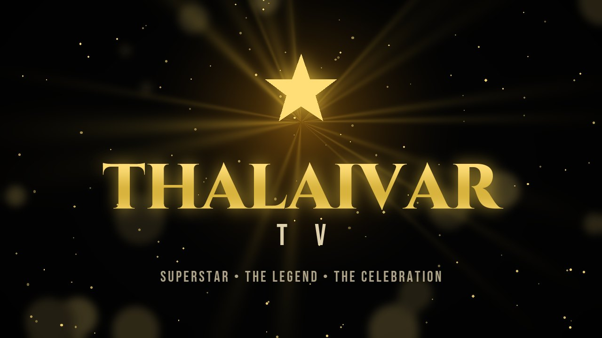
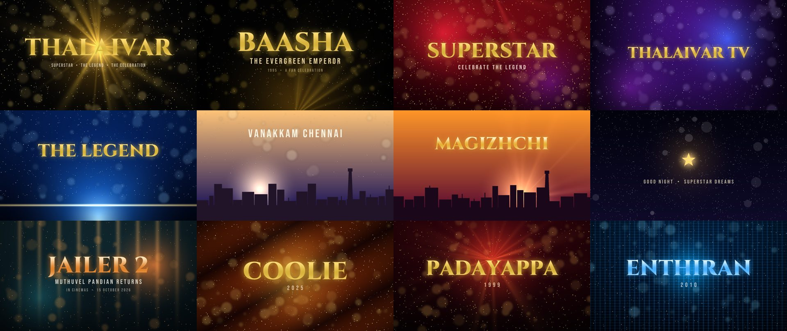

<p align="center"></p>

<h1 align="center">Superstar TV Home ⭐ THALAIVAR TV Edition</h1>

<p align="center">
  <b>Turn any Android TV into a cinematic Superstar Rajinikanth fan world.</b><br>
  Gold-and-black home screen · every Thalaivar film · live news · Baasha &amp; Jailer 2 zones · screensavers<br>
  No root. Nothing deleted. One command to install, one to undo.
</p>

<p align="center">
  
  
  
  
  
</p>

---

## Why

Your TV's home screen is full of ads and "sponsored" rows. **Superstar TV Home** replaces that feeling with a
premium, cinematic home made for Thalaivar fans, built on top of the excellent open-source
**[Clean Your TV](https://github.com/Gathin23/cleanyourtv)** launcher (ad-free, tracker-free, works on almost
every Android TV).

## Features

| | |
|---|---|
| 🏠 **THALAIVAR home theme** | Gold & black cinematic shelf, frosted dock, gold focus glow, "Good morning, Thalaiva" greeting, 12 original 16:9 wallpapers that change with your city's sunrise and sunset, clock screensaver |
| 🏠 **The TV's main home dashboard** | Home button and power-on open THALAIVAR TV. Top menu: Home, Thalaivar Cinema, My Movies, Apps, YouTube, Entertainment, Jarvis, Settings and 🔍 film search. **Continue watching** (videos resume where you stopped), ★ favourites, recently viewed films, and an Entertainment row with JK Tube and your streaming apps. Full D-pad control; On/Off in Settings |
| 🎬 **Thalaivar Hub** | Logo reveal, live clock, featured film with crossfading backdrops, **17 lead films + the full filmography** in 3D poster cards |
| 📖 **Film pages** | Year, runtime, genres, director, music director, cast, official trailers and clips, songs, "Watch on" the streaming apps you have, favourites |
| 👑 **BAASHA – The Evergreen Emperor** | Black-and-gold celebration zone with stage-light rays, confetti and a fan wall, plus its own screensaver |
| 🔥 **JAILER 2 zone** | Release info, box office **with source, date and a "reported estimate" label**, cast, official videos, Jailer 2 news |
| ⚡ **Iconic moments** | Mass entries, style, punch dialogues, comedy, action, interviews, audio launches, fan celebrations: one press opens official YouTube results |
| 📰 **Live news engine** | Rajinikanth, Jailer 2, box office, Dharman and the KH x RK film; every headline shows its publisher, age and a **CONFIRMED / REPORTED / RUMOUR** badge; works offline with the saved copy |
| 🤖 **J.A.R.V.I.S voice assistant** | A floating assistant with its own animated 3D face (an original character): ask anything, "open Netflix", "play Anirudh songs", "latest news". Everyday commands run on the TV in under 2 seconds; questions are answered by Gemini in a natural human voice. You talk to it from the phone remote (English, Tamil, Tanglish) |
| 📱 **Phone control centre (scan once)** | Scan the QR on the J.A.R.V.I.S panel and add it to your home screen. Four tabs: **Remote** (TV standby/wake, D-pad or swipe touchpad, Home, Back, TV menu, recent apps, volume bar you can drag, mute, play/pause, ±10 s, ±30 s, previous/next, stop, TV settings, screensaver), **Jarvis** (chat with replies shown on the phone, phone-keyboard voice), **Apps** (every app on the TV with its icon, searchable) and **Thalaivar** (every dashboard screen, play anything in JK Tube, find a film). Live "Connected" light, volume and now-playing. Stays paired whenever the TV is on |
| ▶️ **JK Tube** | A TV-first video browser: search bar, voice search, official trailers row, trending and Tamil rows (with a YouTube key), and every video plays in JK Tube's own full-screen player; if one can't be embedded, the next match plays |
| 🖼️ **Full-screen photos** | His portraits and every film's stills, one at a time across the whole screen with a 3D swing between them, slideshow, and ★ to add any picture to the screensaver |
| 📺 **Apps hub** | Every app on your TV, auto-sorted into Entertainment, Music, Live TV, Games and Tools; pin your favourites |
| 🖼️ **Wallpapers & screensavers** | Star film stills for the "Thalaivar TV" and "Baasha" screensavers: crossfade, slow zoom, clock and date |
| ⚙️ **Made for TV hardware** | Full remote control, Low / Medium / High animation (auto-picked from the TV's memory), English or Tamil |

<p align="center"></p>

## Install in 3 steps

1. **On the TV:** turn on Developer options and Network/USB debugging, and note the TV's IP address
   ([how, for every brand](docs/GUIDE.md#1-turn-on-debugging-on-your-tv)).
2. **Get a free TMDB token** for the film data: [themoviedb.org/settings/api](https://www.themoviedb.org/settings/api)
   ([step by step](docs/GUIDE.md#2-get-your-free-tmdb-token)).
3. **On a Windows PC on the same Wi-Fi:**

```powershell
git clone https://github.com/jegankumarsparks-source/superstar-tv-home.git
cd superstar-tv-home
powershell -ExecutionPolicy Bypass -File setup.ps1 -TvHost 192.168.1.50
```

Press **OK** on the TV's "Allow debugging?" prompt the first time. Open **Thalaivar TV** from your apps.
Your current home screen is kept; make THALAIVAR TV your Home only when you love it:

```powershell
powershell -ExecutionPolicy Bypass -File cleanyourtv\tools\thalaivar\make-home.ps1 -TvHost 192.168.1.50
```

**Undo everything** (Home, settings and the two apps back as they were):

```powershell
powershell -ExecutionPolicy Bypass -File cleanyourtv\tools\thalaivar\restore.ps1 -TvHost 192.168.1.50
```

Full guide, every TV brand, troubleshooting and FAQ: **[docs/GUIDE.md](docs/GUIDE.md)**.

## Supported TVs

Any **Android TV, Google TV or Fire TV on Android 8.0 or newer**: Sony, TCL, Hisense, Xiaomi / Mi TV & Mi Box,
Philips, OnePlus, Realme, Vu, Acer, Nokia, Kodak, Thomson, iFFALCON, Chromecast with Google TV, NVIDIA Shield,
Google TV Streamer, Fire TV Stick and Cube, and more. Clean Your TV keeps a
[list of tested models](https://github.com/Gathin23/cleanyourtv#readme). Samsung (Tizen), LG (webOS), Roku
and other non-Android TVs are not supported.

## Safe by design

- **Nothing is deleted or disabled.** Your apps, Play Store, Netflix certification and system settings stay as they are.
- **Backup first:** the installer saves your Home, app list and settings before it changes anything.
- **Your Home is never changed without you:** `make-home.ps1` asks you to type YES, and `restore.ps1` undoes it.
- **No ads, no tracking.** The hub contacts only TMDB (film data), Google News RSS (headlines), and — only if you add the keys — Gemini (the assistant) and the YouTube Data API (JK Tube search).
- **Your keys stay yours.** They live in a git-ignored file on your PC and in your own build of the app; nothing is committed.

## How it is built

```
overlay/                     added on top of Clean Your TV (pinned, tested commit)
  themes/thalaivar/          the THALAIVAR theme: config + 12 original wallpapers
  addons/thalaivar-hub/      the hub app (Java, no extra libraries), a Clean Your TV module card
  launcher/.../values-ta/    Tamil strings for the launcher (optional)
  tools/thalaivar/           install, restore, make-home, art generator, personal poster wallpapers
setup.ps1                    clone Clean Your TV, add the overlay, build, install
docs/GUIDE.md                the full guide
```

## Credits and disclaimer

- **[Clean Your TV](https://github.com/Gathin23/cleanyourtv)** by Gathin23 and contributors: the launcher,
  tools and safety rules this edition stands on (MIT).
- Film data and images: **TMDB**, loaded on your TV at run time. *This product uses the TMDB API but is not
  endorsed or certified by TMDB.* Headlines belong to their publishers (via Google News RSS); videos play in the
  YouTube app from their owners.
- The logo and all wallpapers in this repository are original artwork, generated by
  `overlay/tools/thalaivar/make_art.py`. Fonts: Cinzel, Bebas Neue, Montserrat (SIL Open Font License).
- **Unofficial fan project.** Not affiliated with or endorsed by Rajinikanth, any production house, streaming
  service, Google or Amazon. No film footage, posters or music are included in this repository.

⭐ **If this made your TV feel like first-day-first-show, star the repo and share it with a fellow fan!**
